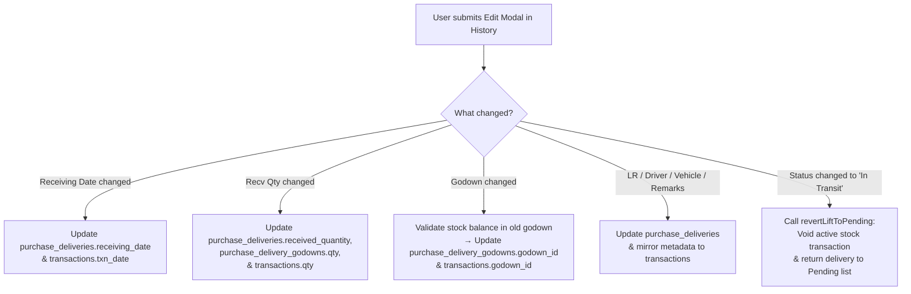

# Implementation Plan: Editable Aawak Details History Form

## 1. Overview & Objective
In **Purchase → Aawak Details**, users record delivery intake details directly in the **Pending** tab:
- `Receiving Date`
- `Recv. Qty`
- `Godown Name`
- `Review / Remarks`
- `Status`
- `Driver No.`
- `Vehicle No.`
- `LR No.`
- `Exp. Recv. Date`

Currently, when clicking the **Edit** action on a lift in the **History** tab, the `EditAawakLiftModal` is missing crucial receipt fields (`Receiving Date`, `Received Qty`, `Godown Name`, `Status`) and has `LR Number` locked as read-only.

**Goal:** 
Bring all fields that are filled in the **Pending** section into the **History Edit Form**, make them fully editable, and ensure that changes accurately update the delivery record, godown allocation, and linked stock ledger transactions (`PURCHASE_IN` in `transactions` table).

---

## 2. Field Comparison & Mapping

| Field Name | Database Column / Source | Pending Tab Table | History Edit Modal (Current) | History Edit Modal (Proposed) |
|---|---|---|---|---|
| **Receiving Date** | `purchase_deliveries.receiving_date` | Editable DatePicker | ❌ *Missing* | ✅ **Editable DatePicker** |
| **Recv. Qty** | `purchase_deliveries.received_quantity` | Editable Number Input | ❌ *Missing* | ✅ **Editable Number Input** |
| **Godown Name** | `purchase_delivery_godowns.godown_id` | Editable Select Dropdown | ❌ *Missing* | ✅ **Editable Select Dropdown** (Own Godowns) |
| **Status** | `purchase_deliveries.status` | Editable Select Dropdown | ❌ *Missing* | ✅ **Editable Select Dropdown** (`Arrived`, `In Transport Godown`, `In Transit`) |
| **LR Number** | `purchase_deliveries.lr_number` | Editable Text Input | 🔒 Locked / Read-only | ✅ **Editable Text Input** |
| **Expected Recv Date** | `purchase_deliveries.expected_delivery_date` | Editable DatePicker | ✅ Editable DatePicker | ✅ **Editable DatePicker** |
| **Driver Phone No.** | `purchase_deliveries.driver_phone_number` | Editable Text Input | ✅ Editable Text Input | ✅ **Editable Text Input** |
| **Vehicle No.** | `purchase_deliveries.vehicle_number` | Editable Text Input | ✅ Editable Text Input | ✅ **Editable Text Input** |
| **Remarks / Review** | `purchase_deliveries.remarks` | Editable Text Input | ✅ Editable Text Input | ✅ **Editable Text Input** |
| **Dispatch Qty (KG & Bags)**| `dispatch_qty_kg` / `dispatch_qty_bag` | Read-only in Table | ✅ Editable Number Inputs | ✅ **Editable Number Inputs** (with auto kg/bag conversion) |
| **Dispatch Date** | `purchase_deliveries.delivery_date` | Read-only in Table | ✅ Editable DatePicker | ✅ **Editable DatePicker** |
| **Lifting Number** | `purchase_deliveries.lifting_number` | Read-only in Table | 🔒 Read-only | 🔒 **Read-only** (Identity key for stock ledger) |
| **Product Name** | `purchase_indent_items.product_id` | Read-only in Table | 🔒 Read-only | 🔒 **Read-only** (Identity key for stock ledger) |
| **Transporter** | `purchase_deliveries.transporter_id` | Read-only in Table | 🔒 Locked in History | 🔒 **Locked in History** (Already received in godown) |

---

## 3. Stock Consistency & Ledger Impact

Lifts in the **History** tab are in `Arrived` or `Received` status, meaning they have an active `PURCHASE_IN` transaction in the `transactions` table and an active allocation record in `purchase_delivery_godowns`.



### Critical Rules:
1. **Receiving Date Validation:** Cannot be a future date (`receiving_date <= today`).
2. **Quantity Validation:** Must be greater than 0 if status is `Arrived` or `In Transport Godown`.
3. **Godown Validation:** Must specify a valid destination godown if status is `Arrived`.
4. **Reverting to In Transit:** If status is changed from `Arrived` back to `In Transit`, the active stock transaction must be voided via `revertLiftToPending`, returning the lift to Pending.

---

## 4. Step-by-Step Implementation Details

### Step 1: Pass Godowns to Modal in `AawakDetailsTable.jsx`
* **File:** `src/pages/Purchase/components/AawakDetailsTable.jsx`
* **Changes:**
  * Currently, `<EditAawakLiftModal>` only receives `products`, `transporters`, `delivery`, `activeSubTab`, and `user`.
  * Pass `godowns={ownGodowns}` (filtered to own godowns) so the modal can populate the destination godown dropdown.

```jsx
<EditAawakLiftModal
  isOpen={!!editingLift}
  onClose={() => setEditingLift(null)}
  delivery={editingLift}
  activeSubTab={activeSubTab}
  products={products}
  transporters={transporters}
  godowns={ownGodowns}
  user={user}
  onSuccess={loadData}
/>
```

---

### Step 2: Update Form State & Props in `EditAawakLiftModal.jsx`
* **File:** `src/pages/Purchase/components/EditAawakLiftModal.jsx`
* **Changes:**
  1. Receive `godowns = []` in component props.
  2. Add new fields to `form` state:
     - `receiving_date`
     - `received_quantity`
     - `godown_id`
     - `status`
  3. Pre-fill state when opening:
     ```javascript
     const existingGodownId = delivery.purchase_delivery_godowns?.[0]?.godown_id
       || delivery.purchase_indent_items?.approved_godown_id
       || delivery.godown_id
       || '';

     setForm({
       ...
       receiving_date: delivery.receiving_date ? delivery.receiving_date.slice(0, 10) : '',
       received_quantity: delivery.received_quantity != null ? String(delivery.received_quantity) : '',
       godown_id: existingGodownId ? String(existingGodownId) : '',
       status: delivery.status === 'AT TPT GDN' ? 'In Transport Godown' : (delivery.status || 'Arrived'),
     });
     ```
  4. Allow editing `lr_number` in History (remove read-only restriction on LR number).

---

### Step 3: Add UI Form Controls in `EditAawakLiftModal.jsx`
* **File:** `src/pages/Purchase/components/EditAawakLiftModal.jsx`
* **Changes:**
  Add a dedicated **"Receipt & Storage Details"** section in the modal body:
  1. **Receiving Date:** DatePicker with `showActions`, restricted to today or past dates.
  2. **Received Qty:** Number input with unit label (e.g. Bags / KG) matching the product.
  3. **Godown Name:** Dropdown `<select>` populated from `godowns` prop.
  4. **Status:** Dropdown `<select>` with options:
     - `Arrived` (Goods received in warehouse)
     - `In Transport Godown` (Held at transporter warehouse)
     - `In Transit` (Reverts lift back to Pending)

---

### Step 4: Update Backend Service in `purchaseService.js`
* **File:** `src/services/purchaseService.js`
* **Changes:**
  In `updateAawakLiftInfo` (or calling `applyAawakLiftUpdate`):
  1. Handle updates to `receiving_date`, `received_quantity`, `godown_id`, and `status`.
  2. When `godown_id` is changed:
     - Update `purchase_delivery_godowns.godown_id`.
     - Update `purchase_indent_items.approved_godown_id`.
     - Update `transactions.godown_id` on the active `PURCHASE_IN` transaction.
  3. When `received_quantity` is changed:
     - Update `purchase_deliveries.received_quantity`.
     - Update `purchase_delivery_godowns.qty`.
     - Update `transactions.qty` on the active `PURCHASE_IN` transaction.
  4. When `receiving_date` is changed:
     - Update `purchase_deliveries.receiving_date`.
     - Update `transactions.txn_date`.
  5. When `status` is changed to `'In Transit'`:
     - Call `revertLiftToPending` to void the stock entry and move the record back to the Pending tab.

---

## 5. Verification & Testing Checklist

- [ ] **Modal Population:** Click the Edit pencil icon on any lift in the **History** tab; verify that `Receiving Date`, `Received Qty`, `Godown Name`, and `Status` are pre-filled with the existing values.
- [ ] **LR Number Editing:** Confirm LR Number can now be edited to fix typos.
- [ ] **Date Update:** Change the `Receiving Date`; verify both the table and `transactions.txn_date` update.
- [ ] **Quantity Update:** Change `Received Qty`; verify the new quantity displays in the table and updates stock in `Live Stock Dashboard`.
- [ ] **Godown Change:** Change the godown from Godown A to Godown B; verify the stock deduction from Godown A and addition to Godown B in the ledger.
- [ ] **Status Reversion:** Change status to `In Transit`; verify the lift moves out of History and appears in the Pending list, with its stock transaction voided.
- [ ] **Pending Tab Regression Test:** Verify editing in the Pending tab (batch edits & single row edits) continues to function without issues.
